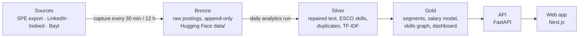

<p align="center"></p>

<h1 align="center">SEXTANTE</h1>

<p align="center">
  <b>The Colombian job market, read from the text of its job postings.</b><br>
  Skill extraction · occupational segmentation · salary estimation · CV matching
</p>

---

## What it is

SEXTANTE collects every job posting it can find in Colombia (the official
Servicio Público de Empleo export plus LinkedIn, Indeed and Bayt), turns their
free-text descriptions into structured data and serves the result as a web
app where:

- **candidates** upload a CV and see which real vacancies they resemble (with
  a match %, a link to apply, the skills they lack and roles they could move
  to);
- **employers** compare salaries, modalities and the skills asked in their
  sector;
- **academic programs** see what the market asks for each education level.

**The problem it solves.** A title like *"Analista junior"* hides very
different jobs. What a vacancy really asks for is written in its description,
in free text, with no shared taxonomy. SEXTANTE reads those descriptions at
scale (hundreds of thousands of postings) and measures which skills are asked,
how much each kind of work pays and how occupations relate to each other.

An academic project of the Universidad Tecnológica de Bolívar (data mining and
analytics course).

## How it works



1. **Capture** (`backend/src/sextante/ingestion`): every source is translated
   into one 17-column schema and appended to stores that never rewrite a
   posting; they are published on Hugging Face, which is the project's
   persistent memory.
2. **Analytics** (`backend/src/sextante/analytics`): text repair, ESCO skill
   extraction, near-duplicate detection, TF-IDF, topics, occupational
   segments, a salary-band model and a skills graph.
3. **Serve** (`backend/src/sextante/api` + `frontend/`): the API loads the
   latest analytics run and answers the dashboard and CV-matching requests.

Each technique is explained, with its real parameters, in
[docs/techniques.md](docs/techniques.md); the web app's "Cómo funciona"
section shows the same pipeline running live on example rows.

## Repository layout

```
SEXTANTE/
├── backend/                     # everything Python: one installable package, `sextante`
│   ├── src/sextante/
│   │   ├── core/                # shared contract: 17-column schema, repo paths, .env
│   │   ├── ingestion/           # capture: SPE + JobSpy → append-only stores → Hugging Face
│   │   ├── analytics/           # cleaning, ESCO, duplicates, TF-IDF, segments, salary, graph
│   │   └── api/                 # FastAPI: dashboard aggregates and CV matching
│   ├── tests/                   # unittest suite
│   ├── requirements/            # pinned dependencies (base, analysis, api, dev, embeddings, notebooks)
│   ├── pyproject.toml           # package definition + ruff
│   └── Dockerfile               # API image (Render)
├── frontend/                    # Next.js web app: landing, dashboard, CV flow (Vercel)
├── data/                        # local stores and runs; gitignored, rebuilt from Hugging Face
├── docs/                        # architecture, data, techniques, analytics, MVP, roadmap
├── notebooks/                   # course demo notebook
├── scripts/capture.sh           # manual local capture
├── .github/workflows/           # scheduled capture, daily analytics, CI
└── render.yaml                  # Render blueprint for the API
```

**Why no `shared/` folder?** Frontend and backend share no code. They share a
*contract*: the 17-column schema (`backend/src/sextante/core/schema.py`) and
the API responses (typed in `frontend/lib/api.ts`). `sextante.core` is that
shared layer.

## Quick start

All commands run from the repository root. Python ≥ 3.10 with
[uv](https://docs.astral.sh/uv/), Node ≥ 20.

### See the app with demo data (no tokens needed)

```bash
uv venv && uv pip install -r backend/requirements/api.txt && uv pip install --no-deps -e backend
.venv/bin/python -m sextante.analytics demo                # synthetic run → data/analysis/runs/
.venv/bin/uvicorn sextante.api.main:app --port 8000        # API on http://localhost:8000
cd frontend && npm install && npm run dev                  # web app on http://localhost:3000
```

### Capture postings

```bash
uv pip install -r backend/requirements/base.txt && uv pip install --no-deps -e backend
.venv/bin/python -m sextante.ingestion probe                       # which job boards answer for Colombia
.venv/bin/python -m sextante.ingestion pull    --dataset all       # restore the corpus from Hugging Face
.venv/bin/python -m sextante.ingestion capture --source jobspy --results 100
.venv/bin/python -m sextante.ingestion capture --source spe
.venv/bin/python -m sextante.ingestion emit    --dataset all --upload
```

`pull` and `--upload` need an `HF_TOKEN` in a `.env` at the repository root
(gitignored) or exported; never commit it.

### Run analytics on the real corpus

```bash
.venv/bin/python -m sextante.analytics run --esco-csv skills_es.csv [--upload]
```

Details (ESCO taxonomy, artifacts, GitHub Actions run) in
[docs/architecture.md](docs/architecture.md#analytics-runs).

### Tests and lint

```bash
.venv/bin/python -m unittest discover -s backend/tests
ruff check backend
node frontend/scripts/check-guide.ts                       # the web guide's in-browser pipeline
```

CI runs the Python suite and ruff on every push and pull request.

## Automation and deployment

| What | Where | When |
|---|---|---|
| JobSpy capture | `.github/workflows/jobspy_capture.yml` | every 30 min (:17, :47 UTC) |
| SPE capture | `.github/workflows/spe_12h.yml` | 04:23 and 16:23 UTC |
| Analytics run + API redeploy | `.github/workflows/analytics.yml` | daily 06:00 UTC |
| Tests + lint | `.github/workflows/tests.yml` | every push / PR |
| API | Render (`render.yaml` → `backend/Dockerfile`) | on deploy hook / push |
| Web app | Vercel (root directory `frontend`) | on push |

The capture workflows share a concurrency group so they never upload to
Hugging Face at the same time; the off-peak minutes avoid GitHub's delayed
cron slots.

## Data

The corpus lives in the **private** Hugging Face dataset
`pxtron/vacantes-colombia` (ask the team for access): weekly SPE and daily
JobSpy Parquet files with English column names and Spanish values. Sources,
schema, layers and guarantees are documented in [docs/data.md](docs/data.md);
which boards work for Colombia and why, in
[docs/data.md](docs/data.md#source-viability).

## Ethics

- Only public job postings; no personal data of candidates. CVs sent to the
  app are processed in memory and never stored.
- SPE data comes from the portal's official export. Job boards are queried
  with an identifiable User-Agent, throttled, respecting `robots.txt`, with no
  block evasion, proxies or personal credentials.

## Documentation

| Document | Read it to understand… |
|---|---|
| [docs/architecture.md](docs/architecture.md) | how the system is built and run: C4 model, data flow, analytics runs, API, web app, hosting, design decisions |
| [docs/data.md](docs/data.md) | the data: sources and their viability, 17-column schema, bronze/silver/gold layers, artifacts, invariants |
| [docs/techniques.md](docs/techniques.md) | every technique of the pipeline, its parameters and outputs |
| [AGENTS.md](AGENTS.md) | working rules for AI agents in this repository |

## Project stages

| Stage | Status |
|---|---|
| 1 · Data capture | ✅ running (SPE + LinkedIn + Indeed + Bayt → Hugging Face) |
| 2 · Text mining (ESCO skills, duplicates, EDA) | ✅ baseline; manual validation pending |
| 3 · Representations (TF-IDF, NMF, optional embeddings) | ✅ baseline; Word2Vec in the notebook |
| 4 · Segmentation (SVD + K-Means; Ward, DBSCAN, t-SNE compared) | ✅ |
| 5 · Supervised models (salary bands) | ✅ |
| 6 · Skills–occupations graph | ✅ |
| 7 · Distributed processing (Spark) | ⏸ not needed at the current volume |
| 8 · MVP web app (FastAPI + Next.js) | ✅ |

## Team

| Member | Code |
|---|---|
| Alejandro Patrón Montero | T00078181 |
| Shalom Jhoana Arrieta Marrugo | T00082962 |
| Karla Andrea Barraza Torres | T00082880 |
| Katlyn Gutiérrez Cardona | T00082259 |
