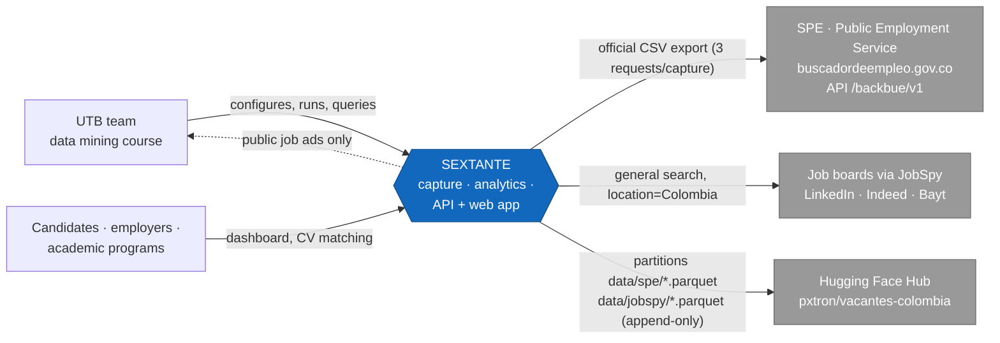
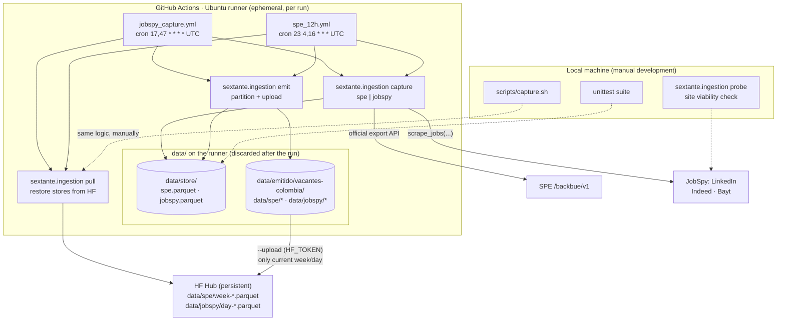
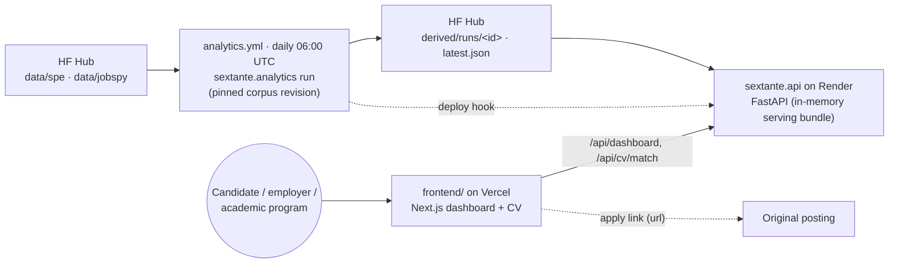
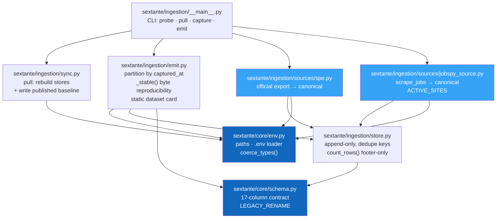
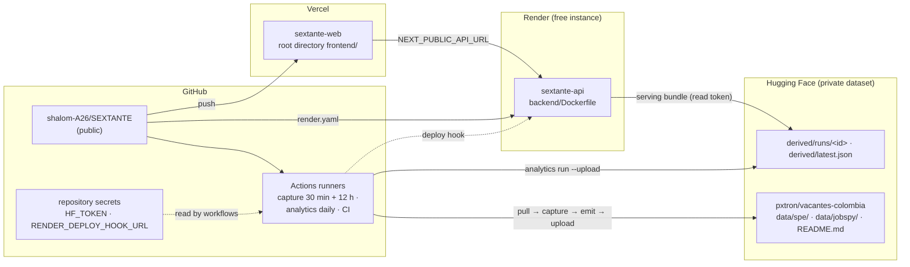
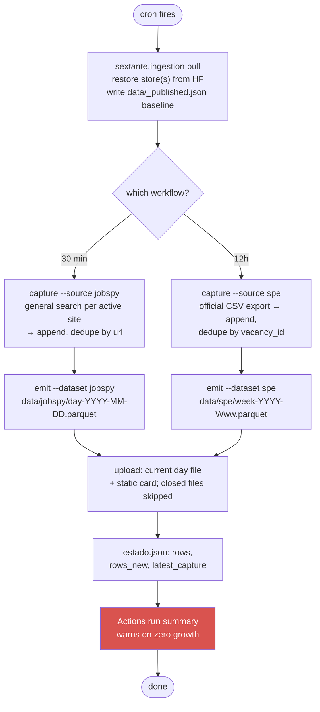
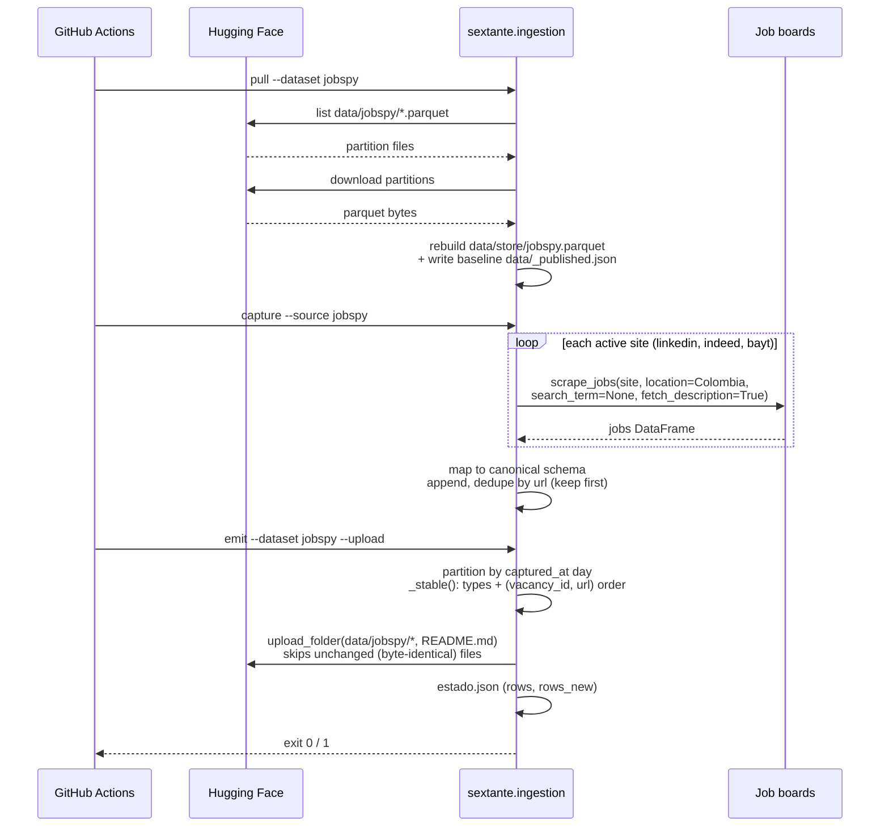
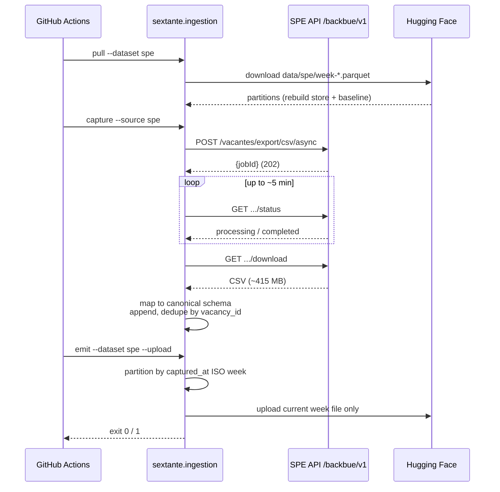

# SEXTANTE architecture

> [README](../README.md) · [Data](data.md) · [Techniques](techniques.md)

How SEXTANTE is built: C4 model (context, containers, components,
deployment), the scheduled data flow, the capture sequences and the design
decisions. The data itself (schema, medallion layers, layouts) is in
[data.md](data.md); what each technique does is in
[techniques.md](techniques.md). All diagrams are **Mermaid** so they render
in docs, editors and GitHub.

## Contents

1. [Summary](#summary)
2. [C4 model](#c4-model)
   - [Level 1 · Context](#level-1--context)
   - [Level 2 · Containers](#level-2--containers)
   - [Level 3 · Components](#level-3--components)
   - [Level 4 · Deployment](#level-4--deployment)
3. [Data flow and scheduled capture](#data-flow-and-scheduled-capture)
4. [Data layers](#data-layers) (details in [data.md](data.md))
5. [Sequence: JobSpy capture](#sequence-jobspy-capture)
6. [Sequence: SPE export](#sequence-spe-export)
7. [Analytics runs](#analytics-runs)
8. [API](#api)
9. [Web app](#web-app)
10. [Hosting](#hosting)
11. [Design decisions](#design-decisions)
12. [Architecture changelog](#architecture-changelog)

---

## Summary

SEXTANTE has three parts that share one data contract (the 17-column
schema in `backend/src/sextante/core/schema.py`):

- **Capture** (`sextante.ingestion`): an ELT pipeline of Colombian job
  postings, described step by step below.
- **Analytics** (`sextante.analytics`): a daily batch run that reads a pinned
  revision of the corpus and publishes derived artifacts under `derived/`
  (see [Analytics runs](#analytics-runs), [techniques.md](techniques.md)).
- **Product** (`sextante.api` + `frontend/`): a FastAPI service that loads
  the latest run and a Next.js web app with the dashboard and the CV flow
  (see [API](#api) and [Web app](#web-app)).

The capture pipeline:

1. **Extract** from two source groups: the official SPE export (massive,
   ~285k rows/capture) and JobSpy job boards (LinkedIn, Indeed, Bayt) with a
   general search for Colombia.
2. **Normalize** everything to the **canonical 17-column schema**
   (`backend/src/sextante/core/schema.py`, `normalize()` / `validate()`).
3. **Save** in two **append-only local stores** (`data/store/spe.parquet`,
   `data/store/jobspy.parquet`). A vacancy already seen is never rewritten;
   `captured_at` stays fixed at the first observation.
4. **Persistent memory = Hugging Face**: `python -m sextante.ingestion pull` recomposes the
   local stores from the published partitions before each run;
   `python -m sextante.ingestion emit` publishes them back. The runner is ephemeral, so without
   this step there is no accumulation.
5. **Capture is automated**: every 30 minutes for JobSpy
   (`.github/workflows/jobspy_capture.yml`, cron `17,47 * * * *` UTC) and
   twice a day for SPE (`.github/workflows/spe_12h.yml`, cron `23 4,16 * * *`
   UTC). Both share the `hf-upload` concurrency group. Cron minutes are
   deliberately off-peak: GitHub delays or drops scheduled runs at
   high-load minutes like :00/:05. There is no local
   cron; `scripts/capture.sh` is the manual development entry point.

**Why two partition grains.** The SPE export is a full snapshot of a portal
that changes slowly: weekly files keep the number of published files low and
each closed week is immutable. JobSpy runs every 30 minutes and surfaces new
postings the same day: daily files give an analysis-friendly time series (one
row per capture day) without creating dozens of files per day that the same
run keeps rewriting. In both cases only the *current* file changes between
runs.

**Upload economics.** Rows are frozen (`keep="first"`), so closed files
never change; `emit._stable()` guarantees identical content produces
identical bytes, and `upload_folder` skips files already present upstream.
Publishing stays cheap no matter how often the cron fires.

---

## C4 model

### Level 1 · Context

Who uses the system and which external systems it talks to.



- **UTB team**: configures and runs the workflows (GitHub Actions) and
  queries the dataset (CLI + Hugging Face).
- **Candidates, employers, academic programs**: use the web app; a CV sent
  for matching is processed in memory and never stored.
- **SPE**: state system offering a mass export (official mechanism, no
  scraping).
- **Job boards**: scraped through JobSpy with ethical criteria
  (identifiable User-Agent, throttling, robots.txt; viability per site in
  [data.md](data.md#source-viability)).
- **Hugging Face Hub**: persistent memory of the pipeline and destination of
  the published dataset.

### Level 2 · Containers

Decomposition into executable containers and data stores. First the
capture side, then analytics and the product.



**Analytics and product containers**



The CV travels only in the request to `/api/cv/match`; nothing is stored.
Details: [Analytics runs](#analytics-runs), [API](#api), [Web app](#web-app).

### Level 3 · Components

Inside the capture side: `sextante.ingestion` plus the shared `sextante.core`.
The analytics modules are listed in [techniques.md](techniques.md); the API
modules in [API](#api).



| Component | Responsibility | Depends on |
|---|---|---|
| `schema` | Canonical columns, `normalize()`, legacy rename map | — |
| `env` | Paths, `.env` loading, stable type coercion | `schema` |
| `store` | Append-only dedupe per dataset, footer-only counts | `env`, `schema` |
| `sync` | Rebuild stores from HF, published baseline | `env` |
| `emit` | Partition, stabilize bytes, card, upload | `env`, `store` |
| `sources.spe` | Official export → canonical | `store`, `env` |
| `sources.jobspy_source` | JobSpy → canonical, active sites | `store`, `env` |
| `__main__` | CLI wiring | everything |

### Level 4 · Deployment



- **Secrets** live in GitHub (`HF_TOKEN` with write scope for the workflows,
  `RENDER_DEPLOY_HOOK_URL`) and in Render (a read-only `HF_TOKEN`); never in
  the repository.
- **API** (Render): the image is built from `backend/Dockerfile` with context
  `backend/`; at start it downloads only the run's `serving/` bundle so it fits
  a 512 MB instance.
- **Web app** (Vercel): Next.js with root directory `frontend/`; it calls the
  API through `NEXT_PUBLIC_API_URL`.
- The local machine is optional: it runs the same CLI manually
  (`scripts/capture.sh`), the demo run and the test suite.

---

## Data flow and scheduled capture



Failure behavior:

- `sextante.ingestion capture` exits with code 1 if a source fails (a restored store
  would otherwise make the run *look* healthy while the corpus stopped
  growing).
- `sextante.ingestion emit` refuses to run when the store is missing (emitting an
  empty store would publish an empty dataset).
- `rows_new` is `null` when there was no pull baseline — growth is never
  invented from the total.

---

## Data layers

The medallion view (landing → bronze → silver → gold), the canonical schema,
the Hugging Face and local layouts and their invariants live in
[data.md](data.md). The techniques that move data between layers are in
[techniques.md](techniques.md).

---

## Sequence: JobSpy capture



## Sequence: SPE export



---

## Analytics runs

### Setup

Use Python 3.12, as configured in the capture workflows, and install the
analysis and development stack:

```bash
.venv/bin/python -m pip install -r backend/requirements/dev.txt
.venv/bin/python -m pip install --no-deps -e backend
```

Download the **ESCO v1.2.1 classification** in Spanish and CSV format from
the [official ESCO download portal](https://esco.ec.europa.eu/en/use-esco/download).
The CSV should include `conceptUri`, `preferredLabel`, and, when available,
`altLabels` and `conceptType`. Keep the taxonomy file out of Git and record
its SHA-256 in every analysis manifest.

Run the complete batch analysis with access to `pxtron/vacantes-colombia`:

```bash
export HF_TOKEN=...
python -m sextante.analytics run --esco-csv /path/to/skills_es.csv
```

The run pins the Hugging Face revision before downloading partitions. Use
`--limit 3000` for a deterministic demonstration capped at 3,000 rows from
each dataset, `--upload` to publish
results, or `--embeddings` to additionally compute multilingual sentence
embeddings. Embeddings require the optional dependencies:

```bash
uv pip install -r backend/requirements/embeddings.txt
```

The embedding model is `sentence-transformers/paraphrase-multilingual-MiniLM-L12-v2`
at revision `b8ef00830037f9868450f778081ea683e900fe39`; it is multilingual and
Apache-2.0 licensed. Embeddings are disabled by default because they add model
downloads, compute time, and storage. `notebooks/01_text_mining_and_segments.ipynb`
is the mini demonstration for the course presentation. It includes optional
small-sample Word2Vec, UMAP, t-SNE, hierarchical, and DBSCAN comparisons.
It runs on synthetic data by default; set `SEXTANTE_USE_HF=1` to use a
private-corpus sample. The full dependency set is installed by
`backend/requirements/dev.txt`.

Execute the complete notebook offline; it uses a generated synthetic sample
unless `SEXTANTE_USE_HF=1` is set:

```bash
.venv/bin/jupyter nbconvert --to notebook --execute \
  --output-dir /tmp/sextante-notebook-run notebooks/01_text_mining_and_segments.ipynb
```

#### Running on GitHub Actions

`.github/workflows/analytics.yml` runs the same command on a GitHub runner
with the repository's `HF_TOKEN` secret and reports wall time and peak
memory in the step summary. It runs **daily at 06:00 UTC** (01:00 Colombia,
after the 04:23 UTC SPE capture) with `--clusters 16 --upload`, and can be
dispatched manually. After a full uploaded run it calls the Render deploy hook
(`RENDER_DEPLOY_HOOK_URL` repository secret) so the API restarts and serves
the new `derived/latest.json`; without the secret it only warns. Once a day on
purpose: each published run adds ~0.5 GB to the dataset's git history. While
it holds the `hf-upload` group (~46 min) at most one JobSpy capture waits and
the one behind it is cancelled by GitHub; the next capture picks those
postings up. The ESCO CSV comes
from the GitHub release
[`taxonomy-esco-v1.2.1`](https://github.com/shalom-A26/SEXTANTE/releases/tag/taxonomy-esco-v1.2.1)
(unmodified official files with EU attribution, verified by SHA-256); set
`esco_source=hf` to read it from the dataset instead.

```bash
gh workflow run analytics.yml -f limit=3000 -f upload=false   # trial
gh workflow run analytics.yml                                 # full run + upload
```

Locally: `gh release download taxonomy-esco-v1.2.1 -p skills_es.csv`.

### Batch behavior

The CLI reads all SPE and JobSpy Parquet partitions from one repository
revision. It creates `data/analysis/runs/<run_id>/` locally. With `--upload`,
the run is uploaded to `derived/runs/<run_id>/` in the same private dataset;
`derived/latest.json` is updated only after the complete run upload succeeds.
The existing capture workflow uploads only `data/spe/`, `data/jobspy/`, and
the dataset card, so it does not overwrite derived outputs.

Before any stage, the run repairs double-encoded text (`cleaning.repair_frame`)
and maps department spellings onto the 33 SPE names
(`cleaning.normalize_departments`: Indeed codes such as `ANT`/`VAC`, LinkedIn
title case and "Capital District"; a Bogotá city always maps to
`BOGOTÁ, D.C.`). Source rows on HF are never modified. TF-IDF drops
schedule/benefit boilerplate and recruiting-marketing template words
(`features.BOILERPLATE_STOP_WORDS`). Segments are named after their most
common title only when it covers at least 5% of the segment; otherwise they
are labeled `Varios: <top terms>`, and repeated names get a distinguishing
term. The manifest reports `duplicate_postings` and `duplicate_groups`
(pairs linked transitively; lower bounds because candidate pairs are
sampled) next to the raw `duplicate_candidates` pair count.

The files each run writes are listed in
[data.md](data.md#derived-artifacts-silver-and-gold); what produces each one
is in [techniques.md](techniques.md).

### Demo run and manual validation

`python -m sextante.analytics demo` generates a synthetic corpus (flagged as
`synthetic-demo` in the manifest, never uploaded) and runs every stage, so
the API and web app work in a clean clone.

`python -m sextante.analytics review <run_dir>` writes review CSVs (ESCO
mentions, duplicate pairs, segment assignments) with an empty `is_correct`
column; reviewers open the `url` and fill it (`sí`/`no`).
`python -m sextante.analytics evaluate <run_dir>/review` reports precision
with a Wilson 95% interval.

---

## API

### Running locally

```bash
uv pip install -r backend/requirements/api.txt && uv pip install --no-deps -e backend
python -m sextante.analytics demo          # or a real run, or SEXTANTE_HF_REPO
uvicorn sextante.api.main:app --port 8000
cd frontend && cp .env.example .env.local && npm install && npm run dev
```

The API picks its run from `SEXTANTE_RUN_DIR`, else downloads
`derived/latest.json` from `SEXTANTE_HF_REPO` (needs `HF_TOKEN`), else the
newest run under `SEXTANTE_RUNS_ROOT` (default `data/analysis/runs`). Set
`SEXTANTE_HF_REPO=pxtron/vacantes-colombia` to serve the real run: a local
`demo` run no longer shadows it.
`SEXTANTE_CORS_ORIGINS` (comma-separated, default `http://localhost:3000`)
must list the web origin. The web app reads `NEXT_PUBLIC_API_URL` at build
time.

### Endpoints

| Method | Path | Returns |
|---|---|---|
| GET | `/api/health` | Run ID and posting count |
| GET | `/api/dashboard` | Overview KPIs, segments (salary, skills, modality, cities), top skills, skills by education level, salary by department and model metrics, skills graph (top 60 nodes by PageRank with degree, edges among them, top-10 transversal skills by degree and bridges by betweenness, Louvain communities with size and top 3 skills, density / average degree / average clustering of the full graph), segment links, 2D projection, NMF topics (with postings, share, top titles, top segments and over-represented skills when `topic_assignments.parquet` is present), clustering comparison, `skill_insights` (top-30 skill table with transversal / especializada / intermedia kind, PageRank core, shared and missing skills per segment link, top skill pairs by PMI, high-salary share by skill with salary boosts, niche skills) and `community_validation` (Louvain on a PMI-weighted skill graph and each segment's dominant PMI community) |
| GET | `/api/segments/{id}/postings` | Sample postings of a segment, with links |
| POST | `/api/cv/match` | Multipart: `file` (PDF/DOCX/TXT ≤ 5 MB) or `text`; optional `city`, `modality`, `limit` |

The CV-matching method is in
[techniques.md](techniques.md#11-cv-matching-niches-pivots-and-gaps).

### Docker

```bash
docker build -t sextante-api backend
docker run -p 8000:8000 -e SEXTANTE_HF_REPO=pxtron/vacantes-colombia \
  -e HF_TOKEN=<read-only token> -e SEXTANTE_CORS_ORIGINS=https://<web-domain> sextante-api
```

Without `SEXTANTE_HF_REPO` the container builds and serves a synthetic demo
run.

---

## Web app

Next.js 16, React 19, Tailwind v4 + shadcn/ui, GSAP and three.js, in
`frontend/`.


- **shadcn/ui** (`frontend/components/ui/`, radix-nova style). Its CSS variables are
  mapped to the dusk palette in `app/globals.css`. The page's own tokens are
  prefixed `--sx-*` so they don't collide with shadcn's `--muted`,
  `--accent` and `--radius`. The hand-written CSS stays unlayered so it wins
  over Tailwind's preflight.
- **GSAP** (`frontend/components/motion/`). It registers ScrollTrigger,
  ScrollToPlugin, ScrambleText, SplitText and DrawSVG once and exports these primitives:
  `Reveal`, `SplitHeading`, `CountUp` and `Magnetic`.
- **Design language** (`frontend/app/design.css`, inspired by emotion-agency.com
  in SEXTANTE's palette): Boska (display serif) and Switzer (text) from
  Fontshare's CDN (ITF licence: web use, no redistribution, so no font files
  in the repo), Fragment Mono for labels. The wordmark (`components/wordmark.tsx`)
  is "se" + the SEXTANTE logo (`docs/assets/logo.svg`) + "tante". A
  nautical-chart backdrop (`components/shell/chart-backdrop.tsx`: dusk wash,
  contours, graticule with Colombian coordinates, compass rose, grain) sits
  behind every page; surfaces are warm "liquid glass" (blur + gradient
  hairline + inner highlight) like `GlowButton`, not hard 1px borders.
- **Intro gate** (`components/landing/intro.tsx`, once per session): logo,
  tagline, load progress, "Entrar con/sin sonido". The ambient sound
  (`lib/ambient.ts`) is synthesised with Web Audio (wind + soft pad), so there
  are no audio files; the header toggle mutes it. On a hard load of `/` with
  no `sx-intro` in `sessionStorage`, an inline `<head>` script in
  `app/layout.tsx` sets `data-intro-cover` on `<html>` before first paint (a
  full-screen layer with the gate's background), so the landing never flashes
  before the gate mounts; `Intro` removes it once the gate is on screen (a
  10 s timeout in the script is the fail-safe).
- **3D world** (`components/world/`). A procedural three.js dusk valley:
  terrain with vertex colours, a reflecting lake (`Reflector`), standing
  stones, ~70k instanced grass blades swaying in a shader, drifting petals and
  a particle swarm that morphs per chapter (sextant → cloud → salary bars →
  skills graph → CV, `shapes.ts`). Scroll drives the camera along a
  Catmull-Rom path with a hold on each chapter; the pointer tilts it. It
  pauses off screen. Reduced motion or no WebGL2: static SVG `DuskField` with
  the chapters stacked.
- **Landing** (`components/landing/`). `Chapters` (five compositions over the
  world, words swap through masks with an RGB glitch), `WhatWeDo` (paragraph
  lit word by word + the pipeline stages as an active list that jumps to the
  guide), the guide, `Profiles` (segments as an irregular card grid with a
  letter-by-letter data overlay) and `Ledger` (corpus figures as an awards
  table).
- **"Cómo funciona" guide** (`components/guide/`). Graphic first, little text:
  a pipeline map (`pipeline-map.tsx`) draws the 12 techniques as a metro line
  stepping down the medallion lanes (bronze → silver → gold → serving, with
  the real file paths of each layer) while a dot, one posting, travels to the
  active station. Each step shows a compact band (layer, title, one-line
  caption, live corpus figures), an input → technique → output strip for the
  selected row (`flow.tsx`), the step's chart and six row cards; the full
  table, row editing, formulas and details sit in collapsible panels. Six
  example postings (`rows.ts`, fictional and labelled so) are processed live by
  `pipeline.ts`, a TypeScript mirror of the Python (mojibake repair,
  normalization, stopwords/templates, ESCO trie longest match, shingles +
  MinHash(64) + LSH + TF-IDF cosine, TF-IDF, NMF, SVD + K-Means by silhouette,
  salary bands + softmax regression, co-occurrence graph with
  Louvain/PageRank/Dijkstra, CV matching). `node frontend/scripts/check-guide.ts`
  asserts the invariants. See the medallion view in
  [data.md](data.md#medallion-layers).
- **One dashboard request.** `getDashboard()` memoizes its promise, so the
  profiles, ledger, walkthrough and dashboard share a single fetch.
- **Logo:** `docs/assets/logo.svg`, also used as the favicon
  (`frontend/app/icon.svg`).
- **Dashboard tabs** (`components/dashboard/`). Candidates: most requested
  skills and occupational segments (each accordion lists its nearest
  occupations from `segment_links`). Skills (`skills-tab.tsx`, fed by
  `skill_insights`): key skills (core by PageRank, bridges by betweenness,
  and a pivot picker showing shared and missing skills toward nearby
  segments; runs without `core` fall back to the degree ranking),
  transversal vs. specialised skills, skill pairs by PMI, skills and salary
  (share of postings at $2M+ and complement boosts, flagged as association),
  niche skills, and a sortable centrality table in technical details. Market:
  the skills graph with a community legend named by top skills, a community
  structure panel (`community_validation`: PMI modularity, communities,
  dominant community per segment, plus density and average clustering), NMF
  topics as cards (title, share, typical titles, segments, skills; a
  collapsed term list when the run lacks those fields), and collapsed
  technical details for the remaining graph metrics, the 2D projection and
  the clustering comparison. Employers: salary panels (the coverage figure
  lives in the salary distribution note), modality, contracts, cities. Every
  section hides itself when the API bundle predates its fields.
- **Dashboard and CV.**
  - KPIs count up and bars grow.
  - The graph draws its edges.
  - Tabs have a sliding indicator.
  - Results cascade in and meters fill up.
- **Page transitions:** a veil in `app/template.tsx` (opacity only, so fixed layers stay fixed).
- **Reduced motion:** everything runs inside
  `gsap.matchMedia("(prefers-reduced-motion: no-preference)")`. With reduced
  motion the page is static and complete. Mouse parallax runs only with a
  fine pointer.

---

## Hosting

Free hosting has ~512 MB of RAM; the API over the full run needs ~2.5 GB.
Each analytics run therefore also writes a **serving bundle**
(`derived/runs/<run_id>/serving/`, ~32 MB, built by `backend/src/sextante/api/serving.py`;
for an existing run: `python -m sextante.api.serving <run_dir>`):

- the dashboard payload precomputed over the whole corpus (all figures stay
  corpus-wide), segment names/sizes/modal salary bands and centroids;
- every ESCO alias seen, so CV skill detection keeps the full vocabulary;
- the 40,000 most recently captured postings for CV matching (recent ones
  are the most likely to still accept applications).

With `SEXTANTE_SERVING=1` the API downloads only that bundle: ~390 MB peak
RSS, CV match in ~30 ms. Arrow uses the system allocator
(`ARROW_DEFAULT_MEMORY_POOL=system`, set in `backend/Dockerfile`); its default
pools keep ~150 MB of freed buffers.

- **API: Render** (free web service, `render.yaml` blueprint): New →
  Blueprint → this repo; enter `HF_TOKEN` (read access to the dataset) when
  asked. CORS allows `http://localhost:3000` and any `https://*.vercel.app`
  (`SEXTANTE_CORS_ORIGINS`, `SEXTANTE_CORS_ORIGIN_REGEX`). The free instance
  sleeps after 15 min idle; the first request then takes ~1 min.
- **Web: Vercel**, root directory `frontend/`, env `NEXT_PUBLIC_API_URL` = the
  Render URL (build-time variable: redeploy after changing it).
- Hugging Face Docker Spaces were the first choice but now require a PRO
  subscription.

---

## Design decisions

| Decision | Alternative rejected | Why |
|---|---|---|
| Two datasets (`spe/`, `jobspy/`) | Single mixed folder | Different cadence and grain; lets each workflow publish independently without touching the other's files |
| Weekly files for SPE, daily for JobSpy | Hourly files | A run's new rows are tens, not thousands; hourly files would multiply file count for no analytical gain. SPE changes little in 24h |
| Partition by `captured_at` | Partition by `published_at` | Late-arriving historical rows (SPE back to 2021) would force rewriting already-published files |
| Append-only (`keep="first"`) | Upsert latest version | Freezes rows ⇒ immutable closed files ⇒ cheap uploads; `captured_at` keeps its "first seen" meaning |
| HF as the only memory | Local database / CI cache | Runners are ephemeral; HF gives a single durable, queryable source of truth |
| Pull before capture, hard-fail on error | Best-effort pull | Without it a fresh runner would publish an incomplete corpus over a healthy one |
| Static dataset card | Card with live counts | Counts change every run ⇒ bytes change ⇒ re-upload every run. Counts live in `estado.json` instead |
| Footer-only row counts (`count_rows`) | `pd.read_parquet` | Arrow #34314 race: thread-pooled reader alive at shutdown aborts the process with exit 134 |
| One 12h SPE workflow | Hourly SPE capture | ~415 MB export per run, slow-changing portal; 2 runs/day is enough and kinder to a state service |

---

## Architecture changelog

One dated line per change, in system terms. Newest first.

- **2026-11-24** — Skill insights get principled noise rules (same JSON shape, no new run artifact): postings with an identical set of ≥ 4 skills collapse as one template regardless of title and company; skills asked by ≥ 5% of deduped postings are *generic* and are excluded from pivots (replacing the transversal + core + top-20 exclusion) and from the PMI graph before Louvain; pivots use share rules (`shared` ≥ 5% in both segments, `missing` ≥ 5% and lift ≥ 1.5 in the target with at most half that share in the origin); `kind` uses breadth (segments with lift ≥ 1, transversal at ≥ 40% of segments) instead of degree percentile; niche partners use their own floors (≥ 20 together, partner ≥ 50 postings); topic top titles skip placeholders and non-title strings and topic skills need ≥ 10% share.

- **2026-11-24** — `skill_insights` and `community_validation` are cleaned up for the real corpus (same JSON shape): skills are merged by normalized label, near-identical postings (same skill set with the same title or company) are collapsed before co-occurrence, salary, niche, pivot and community figures, pairs rank by NPMI with minimum support and skip synonyms (label containment, shared matcher alias), communities run on a sparse NPMI graph (NPMI ≥ 0.10, ≥ 30 postings, top-10 edges per skill), pivots list distinctive non-generic skills by segment lift, and salary thresholds rise (≥ 100 postings per skill, boosts ≥ 150 per combination). Co-occurrence code moves to the new `api/skill_cooccurrence.py`; no new run artifact.
- **2026-11-24** — Web app: new "Habilidades" dashboard tab built on `skill_insights` (core, bridge and pivot skills, transversal vs. specialised, PMI pairs, skills and salary, niche skills, centrality table; the transversal/bridge panel moves here from Candidates); Market gains a community-structure panel from `community_validation` (density and average clustering move there from the graph-metrics detail) and NMF topics become HR-readable cards when topics carry postings, titles, segments and skills; the corpus quality and sources detail is removed. All new fields are optional and their sections hide on older bundles.
- **2026-11-24** — `/api/dashboard` gains `skill_insights` (skill kinds, PageRank core, segment pivots, PMI pairs, salary associations and boosts, niche skills) and `community_validation` (PMI-weighted Louvain vs. segments), and each topic gains size, titles, segments and skills; built in the new `api/skill_insights.py` over the full run when the dashboard is computed (no new analytics run; full-run downloads now include `topic_assignments.parquet`; serving bundles built before this change lack the new keys until the next bundle build).
- **2026-11-24** — Web app: the dashboard shows transversal and bridge skills, a named community legend, graph metrics and per-segment nearby occupations (replacing the "Ocupaciones vecinas" and "Cobertura salarial" panels; source mix and projection move to technical details); an inline `<head>` script covers `/` before first paint so the intro gate no longer flashes the landing on refresh.
- **2026-11-24** — `/api/dashboard` `graph` gains node degree, `rankings` (transversal skills, bridges), `communities` and full-graph density / average degree / average clustering, computed over the full run when the dashboard is built (in the serving bundle they arrive precomputed; bundles built before this change lack them until the next analytics run).

- **2026-11-19** — Docs consolidated into `architecture.md`, `data.md` and `techniques.md`; `AGENTS.md` gains the docs-sync table and `CLAUDE.md` the stack notes. The dataset card now points to `docs/data.md` for source viability.
- **2026-11-19** — Repository split into `backend/` (one `sextante` package: `core`, `ingestion`, `analytics`, `api`) and `frontend/`. CLIs become `python -m sextante.ingestion` / `python -m sextante.analytics`; the API image builds from `backend/Dockerfile`; Vercel's root directory is `frontend`.
- **2026-11-19** — Web app redesigned: 3D landing, liquid-glass UI and an interactive guide that runs the pipeline techniques in the browser on example rows.
- **2026-11** — Daily analytics run on GitHub Actions with a Render redeploy hook; the API serves a 32 MB `serving/` bundle to fit 512 MB.
- **2026-10-05** — Hugging Face layout migrated to `data/spe/week-*` + `data/jobspy/day-*`; El Empleo scraper replaced by JobSpy boards; schema column names moved to English.
