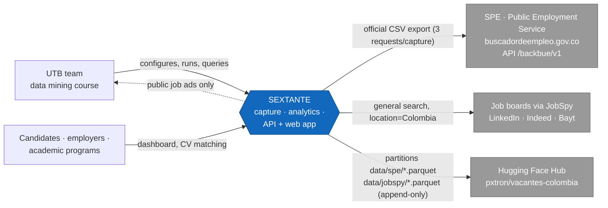
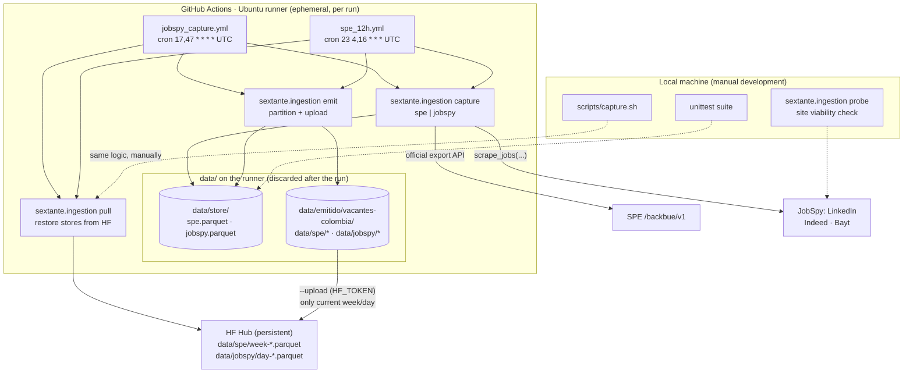
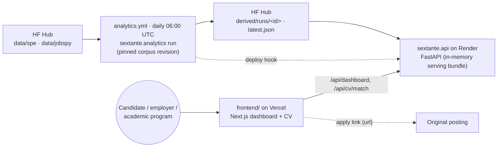
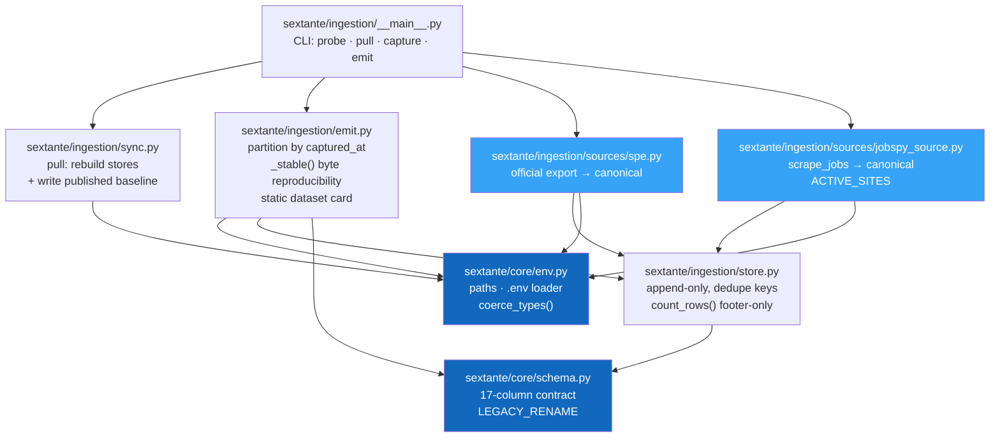
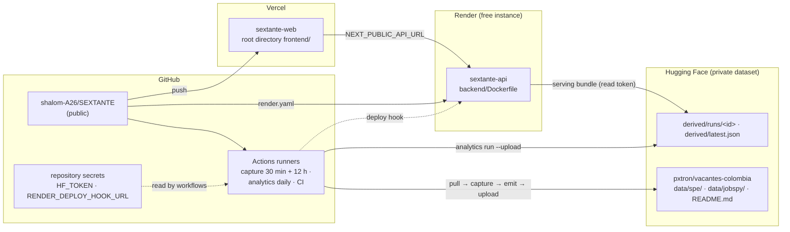
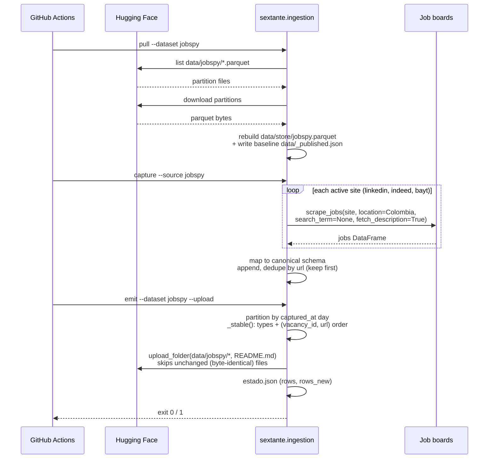
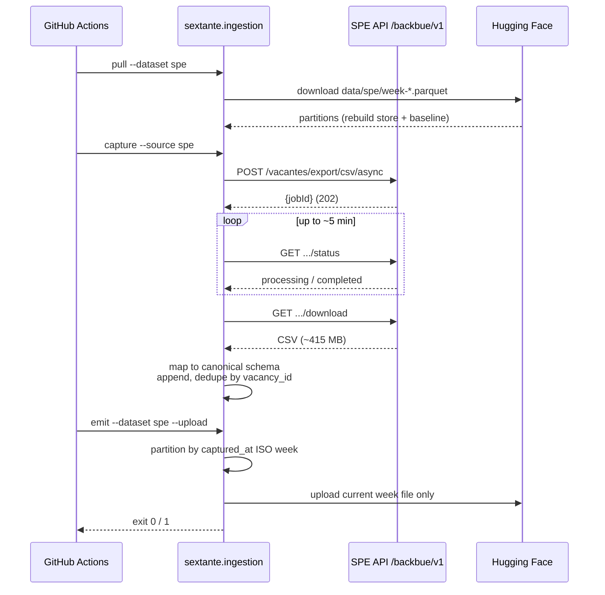

# SEXTANTE architecture

> [README](../README.md) · [Data](data.md) · [Techniques](techniques.md) · [Source viability](source-viability.md)

How SEXTANTE is built: C4 model (context, containers, components,
deployment), the scheduled data flow, the capture sequences and the design
decisions. The data itself (schema, medallion layers, layouts) is in
[data.md](data.md); what each technique does is in
[techniques.md](techniques.md). All diagrams are **Mermaid** so they render
in docs, editors and GitHub.

## Contents

1. [Summary](#summary)
2. [C4 model](#c4-model)
   - [Level 1 · Context](#level-1--context)
   - [Level 2 · Containers](#level-2--containers)
   - [Level 3 · Components](#level-3--components)
   - [Level 4 · Deployment](#level-4--deployment)
3. [Data flow and scheduled capture](#data-flow-and-scheduled-capture)
4. [Data layers](#data-layers) (details in [data.md](data.md))
5. [Sequence: JobSpy capture](#sequence-jobspy-capture)
6. [Sequence: SPE export](#sequence-spe-export)
7. [Design decisions](#design-decisions)

---

## Summary

SEXTANTE has three parts that share one data contract (the 17-column
schema in `backend/src/sextante/core/schema.py`):

- **Capture** (`sextante.ingestion`): an ELT pipeline of Colombian job
  postings, described step by step below.
- **Analytics** (`sextante.analytics`): a daily batch run that reads a pinned
  revision of the corpus and publishes derived artifacts under `derived/`
  (see [analytics.md](analytics.md), [techniques.md](techniques.md)).
- **Product** (`sextante.api` + `frontend/`): a FastAPI service that loads
  the latest run and a Next.js web app with the dashboard and the CV flow
  (see [mvp.md](mvp.md)).

The capture pipeline:

1. **Extract** from two source groups: the official SPE export (massive,
   ~285k rows/capture) and JobSpy job boards (LinkedIn, Indeed, Bayt) with a
   general search for Colombia.
2. **Normalize** everything to the **canonical 17-column schema**
   (`backend/src/sextante/core/schema.py`, `normalize()` / `validate()`).
3. **Save** in two **append-only local stores** (`data/store/spe.parquet`,
   `data/store/jobspy.parquet`). A vacancy already seen is never rewritten;
   `captured_at` stays fixed at the first observation.
4. **Persistent memory = Hugging Face**: `python -m sextante.ingestion pull` recomposes the
   local stores from the published partitions before each run;
   `python -m sextante.ingestion emit` publishes them back. The runner is ephemeral, so without
   this step there is no accumulation.
5. **Capture is automated**: every 30 minutes for JobSpy
   (`.github/workflows/jobspy_capture.yml`, cron `17,47 * * * *` UTC) and
   twice a day for SPE (`.github/workflows/spe_12h.yml`, cron `23 4,16 * * *`
   UTC). Both share the `hf-upload` concurrency group. Cron minutes are
   deliberately off-peak: GitHub delays or drops scheduled runs at
   high-load minutes like :00/:05. There is no local
   cron; `scripts/capture.sh` is the manual development entry point.

**Why two partition grains.** The SPE export is a full snapshot of a portal
that changes slowly: weekly files keep the number of published files low and
each closed week is immutable. JobSpy runs every 30 minutes and surfaces new
postings the same day: daily files give an analysis-friendly time series (one
row per capture day) without creating dozens of files per day that the same
run keeps rewriting. In both cases only the *current* file changes between
runs.

**Upload economics.** Rows are frozen (`keep="first"`), so closed files
never change; `emit._stable()` guarantees identical content produces
identical bytes, and `upload_folder` skips files already present upstream.
Publishing stays cheap no matter how often the cron fires.

---

## C4 model

### Level 1 · Context

Who uses the system and which external systems it talks to.

- **UTB team**: configures and runs the workflows (GitHub Actions) and
  queries the dataset (CLI + Hugging Face).
- **Candidates, employers, academic programs**: use the web app; a CV sent
  for matching is processed in memory and never stored.
- **SPE**: state system offering a mass export (official mechanism, no
  scraping).
- **Job boards**: scraped through JobSpy with ethical criteria
  (identifiable User-Agent, throttling, robots.txt; viability per site in
  [source-viability.md](source-viability.md)).
- **Hugging Face Hub**: persistent memory of the pipeline and destination of
  the published dataset.

### Level 2 · Containers

Decomposition into executable containers and data stores. First the
capture side, then analytics and the product.

**Analytics and product containers**

The CV travels only in the request to `/api/cv/match`; nothing is stored.
Details: [analytics.md](analytics.md), [mvp.md](mvp.md).

### Level 3 · Components

Inside the capture side: `sextante.ingestion` plus the shared `sextante.core`.
The analytics modules are listed in [techniques.md](techniques.md); the API
modules in [mvp.md](mvp.md).

| Component | Responsibility | Depends on |
|---|---|---|
| `schema` | Canonical columns, `normalize()`, legacy rename map | — |
| `env` | Paths, `.env` loading, stable type coercion | `schema` |
| `store` | Append-only dedupe per dataset, footer-only counts | `env`, `schema` |
| `sync` | Rebuild stores from HF, published baseline | `env` |
| `emit` | Partition, stabilize bytes, card, upload | `env`, `store` |
| `sources.spe` | Official export → canonical | `store`, `env` |
| `sources.jobspy_source` | JobSpy → canonical, active sites | `store`, `env` |
| `__main__` | CLI wiring | everything |

### Level 4 · Deployment

- **Secrets** live in GitHub (`HF_TOKEN` with write scope for the workflows,
  `RENDER_DEPLOY_HOOK_URL`) and in Render (a read-only `HF_TOKEN`); never in
  the repository.
- **API** (Render): the image is built from `backend/Dockerfile` with context
  `backend/`; at start it downloads only the run's `serving/` bundle so it fits
  a 512 MB instance.
- **Web app** (Vercel): Next.js with root directory `frontend/`; it calls the
  API through `NEXT_PUBLIC_API_URL`.
- The local machine is optional: it runs the same CLI manually
  (`scripts/capture.sh`), the demo run and the test suite.

---

## Data flow and scheduled capture

Failure behavior:

- `sextante.ingestion capture` exits with code 1 if a source fails (a restored store
  would otherwise make the run *look* healthy while the corpus stopped
  growing).
- `sextante.ingestion emit` refuses to run when the store is missing (emitting an
  empty store would publish an empty dataset).
- `rows_new` is `null` when there was no pull baseline — growth is never
  invented from the total.

---

## Data layers

The medallion view (landing → bronze → silver → gold), the canonical schema,
the Hugging Face and local layouts and their invariants live in
[data.md](data.md). The techniques that move data between layers are in
[techniques.md](techniques.md).

---

## Sequence: JobSpy capture

## Sequence: SPE export

---

## Design decisions

| Decision | Alternative rejected | Why |
|---|---|---|
| Two datasets (`spe/`, `jobspy/`) | Single mixed folder | Different cadence and grain; lets each workflow publish independently without touching the other's files |
| Weekly files for SPE, daily for JobSpy | Hourly files | A run's new rows are tens, not thousands; hourly files would multiply file count for no analytical gain. SPE changes little in 24h |
| Partition by `captured_at` | Partition by `published_at` | Late-arriving historical rows (SPE back to 2021) would force rewriting already-published files |
| Append-only (`keep="first"`) | Upsert latest version | Freezes rows ⇒ immutable closed files ⇒ cheap uploads; `captured_at` keeps its "first seen" meaning |
| HF as the only memory | Local database / CI cache | Runners are ephemeral; HF gives a single durable, queryable source of truth |
| Pull before capture, hard-fail on error | Best-effort pull | Without it a fresh runner would publish an incomplete corpus over a healthy one |
| Static dataset card | Card with live counts | Counts change every run ⇒ bytes change ⇒ re-upload every run. Counts live in `estado.json` instead |
| Footer-only row counts (`count_rows`) | `pd.read_parquet` | Arrow #34314 race: thread-pooled reader alive at shutdown aborts the process with exit 134 |
| One 12h SPE workflow | Hourly SPE capture | ~415 MB export per run, slow-changing portal; 2 runs/day is enough and kinder to a state service |
