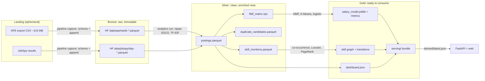

# SEXTANTE data

What data SEXTANTE handles, where each piece lives, the contract every stage
reads and the guarantees each layer keeps. For how the system is built see
[architecture.md](architecture.md); for what each technique does to the data
see [techniques.md](techniques.md).

## Contents

1. [Sources](#sources)
2. [Medallion layers](#medallion-layers)
3. [Canonical schema (17 columns)](#canonical-schema-17-columns)
4. [Published layout (Hugging Face)](#published-layout-hugging-face)
5. [Invariants](#invariants)
6. [Derived artifacts (silver and gold)](#derived-artifacts-silver-and-gold)
7. [Local layout (`data/`)](#local-layout-data)
8. [Rules for handling the data](#rules-for-handling-the-data)
9. [Source viability](#source-viability)

---

## Sources

| Source | How it is obtained | Cadence | Dedupe key |
|---|---|---|---|
| Servicio Público de Empleo (`spe`) | The portal's official CSV export (~415 MB snapshot) | every 12 h | `vacancy_id` (`CODIGO_VACANTE`) |
| Job boards via JobSpy (`linkedin`, `indeed`, …) | General search for Colombia through `python-jobspy`, throttled, identifiable User-Agent | every 30 min | `url` |

Which boards are active and why is detailed in
[Source viability](#source-viability) below. Cross-source duplicates (the same
vacancy on SPE and LinkedIn) are kept in the raw layer and detected later by
text similarity; the `source` column tells them apart.

## Medallion layers

SEXTANTE was not designed as a lakehouse, but its layers map cleanly onto the
medallion pattern (bronze → silver → gold). The web guide ("Cómo funciona")
draws the twelve techniques of [techniques.md](techniques.md) on these lanes.



| Layer | Where it lives | Code | Guarantee |
|---|---|---|---|
| Landing | SPE CSV export, JobSpy responses (never persisted) | `backend/src/sextante/ingestion/sources/` | none: transient |
| Bronze | HF `data/spe/week-*.parquet`, `data/jobspy/day-*.parquet`; local `data/store/<dataset>.parquet` | `backend/src/sextante/ingestion/` (`schema.py`, `store.py`, `emit.py`, `sync.py`) | append-only (`keep="first"`), partitioned by capture date, byte-stable files, 17-column schema; content kept as captured (mojibake, templates, cross-source duplicates) |
| Silver | HF `derived/runs/<run_id>/`: `postings.parquet` (repaired text, normalized departments, `cluster_id`), `skill_mentions.parquet`, `skill_aliases.parquet`, `duplicate_candidates.parquet`, `tfidf_matrix.npz` + vectorizer, `segment_projection.parquet` | `backend/src/sextante/analytics/` (`cleaning.py`, `taxonomy.py`, `duplicates.py`, `features.py`) | row-level, cleaned and enriched; built from a revision-pinned corpus (`corpus.py`) |
| Gold | same run: `dashboard.json`, `segment_stats.json`, `segment_profiles.csv`, `segment_skills.parquet`, `skill_graph_*.parquet`, `segment_transitions.parquet`, `topics.csv`, `supervised_metrics.json`, `salary_model.joblib`, `clustering_comparison.json`, `graph_metrics.json`, `eda.json`; `serving/` bundle; `derived/latest.json` pointer | `backend/src/sextante/analytics/` (`supervised.py`, `graph.py`, `comparison.py`, `run.py`), `backend/src/sextante/api/serving.py` | aggregates and models shaped for the API and the dashboard |

Caveats, so the analogy is not oversold:

- Bronze is not byte-raw: the canonical schema is applied on write
  (schema-on-write), so source-specific fields are already renamed.
- Silver and gold are full snapshots recomputed by each daily run, not
  incremental tables; old runs stay under `derived/runs/` and
  `derived/latest.json` points at the current one.
- Lineage is recorded in each run's `manifest.json` (corpus revision and
  file list); there are no separate data-quality tables, the invariants
  are enforced by tests.

## Canonical schema (17 columns)

| # | Column | Type | Meaning |
|---|---|---|---|
| 1 | `vacancy_id` | text | Primary key: `spe-<CODIGO_VACANTE>` / id from the job URL |
| 2 | `source` | text | Origin: `spe`, `linkedin`, `indeed`, `bayt`, ... |
| 3 | `url` | text | Posting URL (dedupe key for jobspy) |
| 4 | `title` | text | Job title |
| 5 | `company` | text | Employer |
| 6 | `city` | text | City (parsed from the source location) |
| 7 | `department` | text | Department, when the source provides it |
| 8 | `published_at` | text | Publication date as given by the source |
| 9 | `description` | text | Full description, when available |
| 10 | `salary_text` | text | Salary as written (band or range) |
| 11 | `salary_min` | float | Numeric lower bound (COP), when parseable |
| 12 | `salary_max` | float | Numeric upper bound (COP), when parseable |
| 13 | `contract_type` | text | Contract type |
| 14 | `work_modality` | text | `Teletrabajo` / `Remoto`, when flagged |
| 15 | `education_level` | text | Required education, when provided |
| 16 | `experience_text` | text | Experience requirement as text |
| 17 | `captured_at` | text | **First** capture timestamp (`%Y-%m-%d %H:%M:%S`) |

Column names are English (renamed on 2026-10-05 from the original Spanish
schema); values stay in Spanish. Unavailable fields are null.

## Published layout (Hugging Face)

```
data/
├── spe/
│   ├── week-2026-W38.parquet    # rows first captured in ISO week 38
│   ├── week-2026-W41.parquet    # current week (the only file that changes)
│   └── undated.parquet          # rows without a parseable captured_at
└── jobspy/
    ├── day-2026-10-04.parquet   # closed day: immutable
    ├── day-2026-10-05.parquet   # current day (rewritten every capture run)
    └── undated.parquet
```

Plus a static `README.md` (dataset card; identical bytes every run, uploaded
once) and, locally only, `estado.json` (run state, never uploaded).

The batch analytics (`python -m sextante.analytics run --upload`, run
manually) writes to a separate prefix of the same dataset and never touches
`data/`:

```
derived/
├── runs/<run_id>/     # manifest.json, eda.json, skill_mentions.parquet,
│                      # duplicate_candidates.parquet, topics, segments, TF-IDF
└── latest.json        # pointer, updated only after a complete run upload
```

The capture workflows upload only `data/spe/`, `data/jobspy/` and the card,
so they cannot overwrite derived outputs. See [techniques.md](techniques.md) for what produces each derived file.

## Invariants

- **Partition by capture date**: each row lives in the file of the week/day
  it was *first* seen; the row is frozen, so closed files are immutable.
- **Dedupe keys**: `vacancy_id` (spe) / `url` (jobspy).
- **Byte stability**: `_stable()` fixes dtypes and orders rows by
  `(vacancy_id, url)`; same content ⇒ same bytes ⇒ `upload_folder` skips.
- **Baseline**: `data/_published.json` (written by `pull`) is what lets
  `estado.json` report genuinely new rows.

## Derived artifacts (silver and gold)

Each analytics run writes these files to `derived/runs/<run_id>/` (and
`data/analysis/runs/<run_id>/` locally):

| Artifact | Contents |
|---|---|
| `manifest.json` | Corpus revision, input partitions, ESCO version/hash, parameters, counts, model identifiers, artifact hashes |
| `eda.json` | Missingness, description coverage and length, source/category counts, salary quantiles, date coverage |
| `skill_mentions.parquet` | Vacancy/source/URL, ESCO concept URI and label, matched phrase |
| `duplicate_candidates.parquet` | Similarity-ranked review pairs; no automatic deletion or merging |
| `topics.csv`, `topic_assignments.parquet` | NMF topic terms and per-posting topic assignment/weight |
| `occupational_segments.parquet`, `segment_profiles.csv` | K-Means group assignments and representative terms |
| `segment_projection.parquet` | Two-dimensional TruncatedSVD coordinates (sparse PCA approximation) and group ID |
| `tfidf_matrix.npz`, `tfidf_vocabulary.json`, `tfidf_idf.npy` | TF-IDF representation and vocabulary information for later consumers |
| `sentence_embeddings.npy` | Optional normalized multilingual embeddings |
| `postings.parquet`, `tfidf_vectorizer.joblib` | Posting metadata row-aligned with the TF-IDF matrix (no description) and the fitted vectorizer, used by the API to score CVs |
| `clustering_comparison.json`, `segment_projection_tsne.parquet` | Stage 4: K-Means vs Ward hierarchical vs DBSCAN on a 3,000-row SVD-50 sample (silhouette, noise, ARI vs published K-Means) and a t-SNE projection |
| `supervised_metrics.json`, `salary_estimates.parquet`, `salary_model.joblib` | Stage 5: multinomial logistic classifier over six salary bands aligned with the official SPE bands (no regression: postings publish bands, not exact salaries; band midpoints only place a posting inside its band), stratified K-fold metrics (accuracy, macro-F1, within-one-band) next to a majority baseline; per-posting observed/estimated band |
| `segment_skills.parquet` | Share and lift of each ESCO skill inside each segment |
| `skill_graph_nodes.parquet`, `skill_graph_edges.parquet`, `graph_metrics.json` | Stage 6: skill co-occurrence graph (top 400 skills, edges ≥ 2 shared postings), Louvain communities, PageRank, sampled betweenness |
| `segment_transitions.parquet` | Segment graph (3 nearest neighbours by skill-profile cosine) and all-pairs shortest transition routes |

## Local layout (`data/`)

Everything under `data/` is gitignored and rebuildable from Hugging Face; only
the directory skeleton (`data/.gitkeep`) is versioned. Commands run from the
repository root, and `sextante.core.env.ROOT` resolves to it.

```
data/
├── store/<dataset>.parquet        # append-only stores rebuilt by `python -m sextante.ingestion pull`
├── _published.json                # published-row baseline written by pull (powers rows_new)
├── emitido/vacantes-colombia/     # emission output: data/spe/, data/jobspy/, README.md, estado.json
└── analysis/runs/<run_id>/        # local analytics runs (silver + gold), uploaded with --upload
```

## Rules for handling the data

- No personal data of candidates is captured; CVs sent to the API are
  processed in memory and discarded with the response.
- `robots.txt` is respected, requests are throttled and identified with the
  project User-Agent (`sextante.USER_AGENT`); SPE data comes only from its
  official export.
- `captured_at` is the first time a vacancy was seen and is never overwritten;
  `published_at` keeps the source's own format.
- Analytics reads a pinned corpus revision and writes only under `derived/`;
  it never edits or republishes source rows.

## Source viability

Which sources can actually feed the pipeline for Colombia, and why the
active list is what it is. Last full probe: **2026-10-05**
(`python -m sextante.ingestion probe`, `python-jobspy==1.2.0`).

| Source | Status | Evidence |
|---|---|---|
| **SPE** (`buscadordeempleo.gov.co`) | ✅ active | Official mass export via `/backbue/v1` async job: ~285k vacancies/capture, full text, education, salary band, contract type, experience, 2021→today. 3 HTTP requests per capture. |
| **LinkedIn** (JobSpy) | ✅ active | General search `location=Colombia` returns Colombian postings (Bogotá, Medellín, Cartagena, Barranquilla…); 8/8 rows with full descriptions when `fetch_description=True` (~7.6 s for 8 rows). |
| **Indeed** (JobSpy) | ✅ active | 8/8 rows in Colombian cities (Medellín, Cali, Bogotá, Usaquén…) with descriptions, with `country_indeed="colombia"`. Probes in 2026-02 returned 403; it works again as of 2026-10-05. |
| **Bayt** (JobSpy) | ✅ active | 8/8 rows with `location=Colombia` (regional board with Colombian listings). |
| **Glassdoor** (JobSpy) | ❌ discarded | JobSpy raises `Glassdoor is not available for COLOMBIA` (country tuple lacks COLOMBIA). Also Cloudflare-protected. |
| **Google** (JobSpy) | ❌ discarded | `Google returned no job data` for `location=Colombia`. |
| **ZipRecruiter** (JobSpy) | ❌ discarded | HTTP 403 on every attempt. |
| **Naukri** (JobSpy) | ❌ discarded | Ignores the Colombia filter: returns India rows (`Colombia, India` is a locality there). |
| **BDJobs** (JobSpy) | ❌ discarded | Ignores the Colombia filter: 8/8 rows in Bangladesh (Dhaka, Gazipur…). |
| **El Empleo** (`elempleo.com`) | ❌ removed (2026-10-05) | Custom scraper; replaced by JobSpy boards in the refactor. Historic rows (2,603, with LinkedIn) were migrated into `data/spe/` as legacy corpus. |

### Probe method

```bash
python -m sextante.ingestion probe                     # all known sites, location=Colombia
python -m sextante.ingestion probe --sites linkedin,indeed
```

For each site the probe runs a **general search** (no `search_term`,
`location="Colombia"`, `results=8`, `fetch_description=True`) and reports row
count, whether descriptions came back, and a title sample. A site is *viable*
only if it returns rows **located in Colombia** — some boards answer with rows
that ignore the location filter entirely (Naukri, BDJobs), which would poison
the corpus with non-Colombian postings.

#### Latest results (2026-10-05, JobSpy 1.2.0)

| Site | Rows | Descriptions | Locations returned | Verdict |
|---|---|---|---|---|
| linkedin | 8 | 8/8 (full text, ~2.5–3.8k chars) | Cartagena, Medellín, Barranquilla, Cauca/Sucre, Colombia | ✅ |
| indeed | 8 | 8/8 | Medellín, Cali, Bogotá, Usaquén (CO) | ✅ |
| bayt | 8 | 0/8 (listing-level text) | Colombia ×8 | ✅ |
| naukri | 2 | 0/2 | `Colombia, India` (locality in India) | ❌ location ignored |
| bdjobs | 8 | 0/8 | Dhaka, Gazipur, Bangladesh ×8 | ❌ location ignored |
| glassdoor | 0 | — | error: `Glassdoor is not available for COLOMBIA` | ❌ |
| google | 0 | — | error: `Google returned no job data` | ❌ |
| zip_recruiter | 0 | — | error: HTTP 403 | ❌ |

Site availability is not permanent (Indeed went 403 → working again). The
active list lives in `backend/src/sextante/ingestion/sources/jobspy_source.py::ACTIVE_SITES` and
should be re-validated with `python -m sextante.ingestion probe` whenever captures start
returning zero rows.

### SPE: the export API

The public search exposes a REST API under `/backbue/v1` that generates a CSV
export of **all** registered vacancies through an asynchronous job — the same
"CSV (export all vacancies)" button of the web UI:

1. `POST /vacantes/export/csv/async` → `{jobId}` (202 queued)
2. `GET  .../{jobId}/status` → polling until `completed`
3. `GET  .../{jobId}/download` → CSV (~415 MB, UTF-8 BOM)

Observed: ~285k vacancies with complete description, education level,
department, salary band, contract type and experience in months.

Caveats handled in `backend/src/sextante/ingestion/sources/spe.py`:

- The CA chain is incomplete → TLS validation fails systematically; the first
  `SSLError` disables verification for the rest of the run (see
  `_VERIFY_SSL`).
- The export takes up to ~5 minutes of polling at 2 s intervals.
- Download is throttled by nature: 3 requests + status polls per capture,
  twice a day.

### Why JobSpy over direct scraping

- LinkedIn, Indeed and Bayt are behind anti-bot measures (Cloudflare, 403s);
  JobSpy maintains the adapters and their fixes.
- One dependency with a single `scrape_jobs()` interface → one mapping
  function to the canonical schema instead of one scraper per portal.
- Ethical posture is preserved: our identifiable User-Agent is passed
  through (`user_agent=`), searches are general and throttled, and we only
  read what the boards publish without login.

### What was rejected and why (history)

- **Computrabajo**: 403 on list pages for anonymous clients (2026-02 probe).
- **El Empleo**: custom HTML+JSON scraper, brittle to redesigns; superseded by
  JobSpy in the 2026-10-05 refactor.
- **Direct LinkedIn scraping** without JobSpy: would violate our own
  no-block-evasion rule (rotating headers/fingerprints); not acceptable.

### Re-probing

Run `python -m sextante.ingestion probe` and update this table. If a site changes its
verdict, update `ACTIVE_SITES` **and** this section in the same commit.
