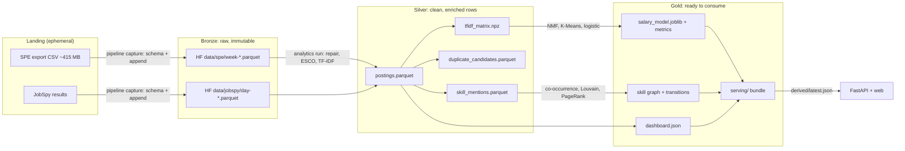

# SEXTANTE data

What data SEXTANTE handles, where each piece lives, the contract every stage
reads and the guarantees each layer keeps. For how the system is built see
[architecture.md](architecture.md); for what each technique does to the data
see [techniques.md](techniques.md).

## Contents

1. [Sources](#sources)
2. [Medallion layers](#medallion-layers)
3. [Canonical schema (17 columns)](#canonical-schema-17-columns)
4. [Published layout (Hugging Face)](#published-layout-hugging-face)
5. [Invariants](#invariants)
6. [Local layout (`data/`)](#local-layout-data)
7. [Rules for handling the data](#rules-for-handling-the-data)

---

## Sources

| Source | How it is obtained | Cadence | Dedupe key |
|---|---|---|---|
| Servicio Público de Empleo (`spe`) | The portal's official CSV export (~415 MB snapshot) | every 12 h | `vacancy_id` (`CODIGO_VACANTE`) |
| Job boards via JobSpy (`linkedin`, `indeed`, …) | General search for Colombia through `python-jobspy`, throttled, identifiable User-Agent | every 30 min | `url` |

Which boards are active and why is documented in
[source-viability.md](source-viability.md). Cross-source duplicates (the same
vacancy on SPE and LinkedIn) are kept in the raw layer and detected later by
text similarity; the `source` column tells them apart.

## Medallion layers

SEXTANTE was not designed as a lakehouse, but its layers map cleanly onto the
medallion pattern (bronze → silver → gold). The web guide ("Cómo funciona")
draws the twelve techniques of [techniques.md](techniques.md) on these lanes.



| Layer | Where it lives | Code | Guarantee |
|---|---|---|---|
| Landing | SPE CSV export, JobSpy responses (never persisted) | `backend/src/sextante/ingestion/sources/` | none: transient |
| Bronze | HF `data/spe/week-*.parquet`, `data/jobspy/day-*.parquet`; local `data/store/<dataset>.parquet` | `backend/src/sextante/ingestion/` (`schema.py`, `store.py`, `emit.py`, `sync.py`) | append-only (`keep="first"`), partitioned by capture date, byte-stable files, 17-column schema; content kept as captured (mojibake, templates, cross-source duplicates) |
| Silver | HF `derived/runs/<run_id>/`: `postings.parquet` (repaired text, normalized departments, `cluster_id`), `skill_mentions.parquet`, `skill_aliases.parquet`, `duplicate_candidates.parquet`, `tfidf_matrix.npz` + vectorizer, `segment_projection.parquet` | `backend/src/sextante/analytics/` (`cleaning.py`, `taxonomy.py`, `duplicates.py`, `features.py`) | row-level, cleaned and enriched; built from a revision-pinned corpus (`corpus.py`) |
| Gold | same run: `dashboard.json`, `segment_stats.json`, `segment_profiles.csv`, `segment_skills.parquet`, `skill_graph_*.parquet`, `segment_transitions.parquet`, `topics.csv`, `supervised_metrics.json`, `salary_model.joblib`, `clustering_comparison.json`, `graph_metrics.json`, `eda.json`; `serving/` bundle; `derived/latest.json` pointer | `backend/src/sextante/analytics/` (`supervised.py`, `graph.py`, `comparison.py`, `run.py`), `backend/src/sextante/api/serving.py` | aggregates and models shaped for the API and the dashboard |

Caveats, so the analogy is not oversold:

- Bronze is not byte-raw: the canonical schema is applied on write
  (schema-on-write), so source-specific fields are already renamed.
- Silver and gold are full snapshots recomputed by each daily run, not
  incremental tables; old runs stay under `derived/runs/` and
  `derived/latest.json` points at the current one.
- Lineage is recorded in each run's `manifest.json` (corpus revision and
  file list); there are no separate data-quality tables, the invariants
  are enforced by tests.

## Canonical schema (17 columns)

| # | Column | Type | Meaning |
|---|---|---|---|
| 1 | `vacancy_id` | text | Primary key: `spe-<CODIGO_VACANTE>` / id from the job URL |
| 2 | `source` | text | Origin: `spe`, `linkedin`, `indeed`, `bayt`, ... |
| 3 | `url` | text | Posting URL (dedupe key for jobspy) |
| 4 | `title` | text | Job title |
| 5 | `company` | text | Employer |
| 6 | `city` | text | City (parsed from the source location) |
| 7 | `department` | text | Department, when the source provides it |
| 8 | `published_at` | text | Publication date as given by the source |
| 9 | `description` | text | Full description, when available |
| 10 | `salary_text` | text | Salary as written (band or range) |
| 11 | `salary_min` | float | Numeric lower bound (COP), when parseable |
| 12 | `salary_max` | float | Numeric upper bound (COP), when parseable |
| 13 | `contract_type` | text | Contract type |
| 14 | `work_modality` | text | `Teletrabajo` / `Remoto`, when flagged |
| 15 | `education_level` | text | Required education, when provided |
| 16 | `experience_text` | text | Experience requirement as text |
| 17 | `captured_at` | text | **First** capture timestamp (`%Y-%m-%d %H:%M:%S`) |

Column names are English (renamed on 2026-10-05 from the original Spanish
schema); values stay in Spanish. Unavailable fields are null.

## Published layout (Hugging Face)

```
data/
├── spe/
│   ├── week-2026-W38.parquet    # rows first captured in ISO week 38
│   ├── week-2026-W41.parquet    # current week (the only file that changes)
│   └── undated.parquet          # rows without a parseable captured_at
└── jobspy/
    ├── day-2026-10-04.parquet   # closed day: immutable
    ├── day-2026-10-05.parquet   # current day (rewritten every capture run)
    └── undated.parquet
```

Plus a static `README.md` (dataset card; identical bytes every run, uploaded
once) and, locally only, `estado.json` (run state, never uploaded).

The batch analytics (`python -m sextante.analytics run --upload`, run
manually) writes to a separate prefix of the same dataset and never touches
`data/`:

```
derived/
├── runs/<run_id>/     # manifest.json, eda.json, skill_mentions.parquet,
│                      # duplicate_candidates.parquet, topics, segments, TF-IDF
└── latest.json        # pointer, updated only after a complete run upload
```

The capture workflows upload only `data/spe/`, `data/jobspy/` and the card,
so they cannot overwrite derived outputs. See [techniques.md](techniques.md) for what produces each derived file.

## Invariants

- **Partition by capture date**: each row lives in the file of the week/day
  it was *first* seen; the row is frozen, so closed files are immutable.
- **Dedupe keys**: `vacancy_id` (spe) / `url` (jobspy).
- **Byte stability**: `_stable()` fixes dtypes and orders rows by
  `(vacancy_id, url)`; same content ⇒ same bytes ⇒ `upload_folder` skips.
- **Baseline**: `data/_published.json` (written by `pull`) is what lets
  `estado.json` report genuinely new rows.

## Local layout (`data/`)

Everything under `data/` is gitignored and rebuildable from Hugging Face; only
the directory skeleton (`data/.gitkeep`) is versioned. Commands run from the
repository root, and `sextante.core.env.ROOT` resolves to it.

```
data/
├── store/<dataset>.parquet        # append-only stores rebuilt by `python -m sextante.ingestion pull`
├── _published.json                # published-row baseline written by pull (powers rows_new)
├── emitido/vacantes-colombia/     # emission output: data/spe/, data/jobspy/, README.md, estado.json
└── analysis/runs/<run_id>/        # local analytics runs (silver + gold), uploaded with --upload
```

## Rules for handling the data

- No personal data of candidates is captured; CVs sent to the API are
  processed in memory and discarded with the response.
- `robots.txt` is respected, requests are throttled and identified with the
  project User-Agent (`sextante.USER_AGENT`); SPE data comes only from its
  official export.
- `captured_at` is the first time a vacancy was seen and is never overwritten;
  `published_at` keeps the source's own format.
- Analytics reads a pinned corpus revision and writes only under `derived/`;
  it never edits or republishes source rows.
